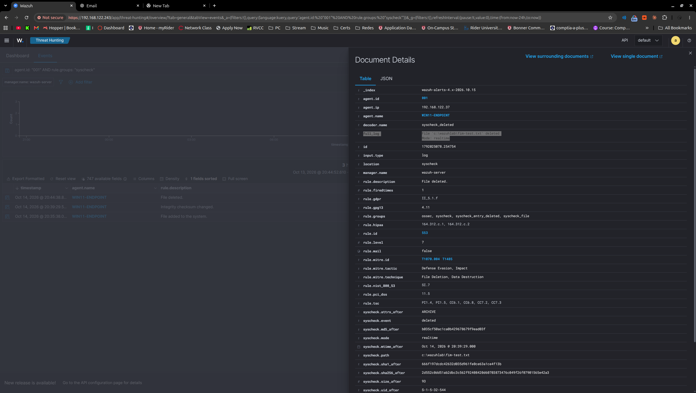
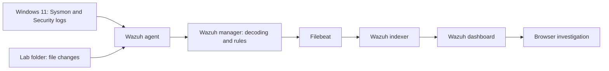

# Wazuh SOC Home Lab

**Completed learning project — Windows monitoring, custom detection, failed-logon investigation, and file integrity monitoring.**

After my [Azure security lab](https://github.com/FloresFreddyGH/azure-security-lab), I wanted to build a monitoring environment on my own computer. I used KVM/QEMU to run an Ubuntu Wazuh server and a Windows 11 endpoint, then followed controlled activity from Windows into the dashboard.

The most useful part was figuring out why something appeared—or did not appear—as an alert. I checked parent processes, investigated a missing whoami alert, built a custom rule, and fixed a three-hour clock discrepancy. I finished by verifying failed-logon alerts and the creation, modification, and deletion of a test file.

## Results

| Exercise | Verified result | Write-up |
| --- | --- | --- |
| Service-change investigation | Identified BITS and UCPD rather than the Wazuh service I initially suspected; cause remains unconfirmed | [Service changes](docs/first-alert-investigation.md) |
| Sysmon and custom detection | Local process event, collection in Wazuh, and live rule 100100 alert for whoami.exe | [Process investigation](docs/sysmon-investigation.md) |
| Clock troubleshooting | Windows synchronized to NTP; fresh event and alert timestamps agreed after timezone conversion | [Time verification](docs/sysmon-investigation.md#clock-correction-and-retest) |
| Failed logons | Three controlled failures; Windows 4625 and Wazuh rule 60122, level 5 | [Authentication investigation](docs/failed-logon-investigation.md) |
| File integrity monitoring | Real-time added, modified, and deleted alerts: rules 554, 550, and 553 | [FIM investigation](docs/file-integrity-investigation.md) |

These were harmless, intentional tests. An alert or MITRE mapping by itself does not establish an attack.

## Architecture

The manager, indexer, Filebeat, and dashboard run together on the Ubuntu VM. The browser is the interface; the server receives and analyzes the events.

| Component | Lab configuration |
| --- | --- |
| Host | Ubuntu desktop, Intel Core i5-14400F, approximately 32 GB RAM |
| Virtualization | KVM/QEMU with Virtual Machine Manager |
| Server | Ubuntu Server 24.04.5 LTS; 4 vCPUs, 8 GiB RAM, 80 GiB disk |
| Platform | Wazuh 4.14.8 |
| Endpoint | Windows 11 Enterprise Evaluation; 4 vCPUs, 8 GiB RAM, 80 GiB disk; Sysmon 15.22 |
| Agent | WIN11-ENDPOINT, ID 001, Wazuh 4.14.8 |
| Network | libvirt default NAT; server 192.168.122.243 and endpoint 192.168.122.37 observed via DHCP |

## Documentation and reusable configuration

- [Lab journal](docs/lab-journal.md): progress, mistakes, and lessons in my own words
- [Setup notes](docs/setup-notes.md): installation and configuration steps
- [Screenshot index](screenshots/README.md): numbered evidence through 44, including limitations
- [Custom rule](configs/whoami-rule.xml): lab snippet, not a replacement rules file
- [Windows collection and FIM snippets](configs/windows-agent-snippets.xml)
- [Portfolio summary](docs/portfolio-summary.md): short project description

## Completion and limits

The defined build and three controlled detection exercises are complete. The test file was deleted, no failed-login test account was created, and the empty lab folder remains monitored. The custom rule and VMs remain available for practice.

This is a small learning environment, not a production SOC deployment. The tests do not establish complete telemetry coverage. I did not complete a scheduled-task exercise, automated response, or a comprehensive hardening project. Sysmon was installed with its default configuration; not all supported event types are necessarily enabled.

The first baseline's 26% configuration score and 19 QEMU guest-agent vulnerability findings were recorded, not remediated or independently validated here. Snapshot boot repair succeeded, but restore testing remains unverified. SSH keys, stable addressing, deliberate upgrade procedures, and broader detection tuning are future improvements rather than completed claims.

## References and assistance

- [Wazuh quickstart](https://documentation.wazuh.com/current/quickstart.html)
- [Wazuh custom rules](https://documentation.wazuh.com/current/user-manual/ruleset/rules/custom.html)
- [Wazuh FIM proof of concept](https://documentation.wazuh.com/current/proof-of-concept-guide/poc-file-integrity-monitoring.html)
- [Microsoft Sysmon](https://learn.microsoft.com/en-us/sysinternals/downloads/sysmon)
- [Microsoft event 4625](https://learn.microsoft.com/windows/security/threat-protection/auditing/event-4625)

I used official documentation and ChatGPT/Codex for explanations, troubleshooting, and organizing the repository. I performed the VM configuration, ran the tests, and checked the evidence. Passwords, raw credential output, VM disks, and installers are excluded from Git.
